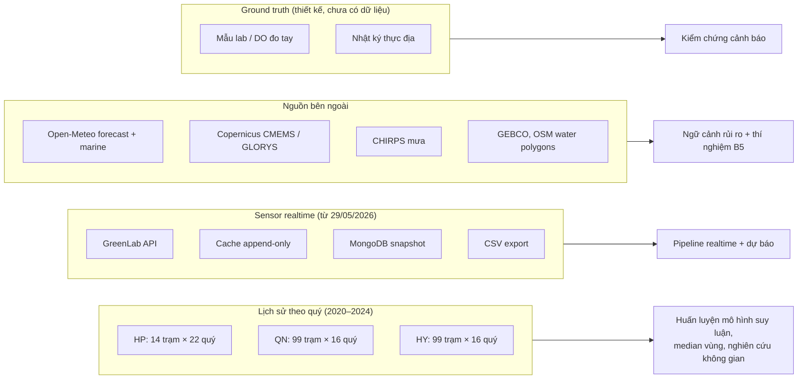
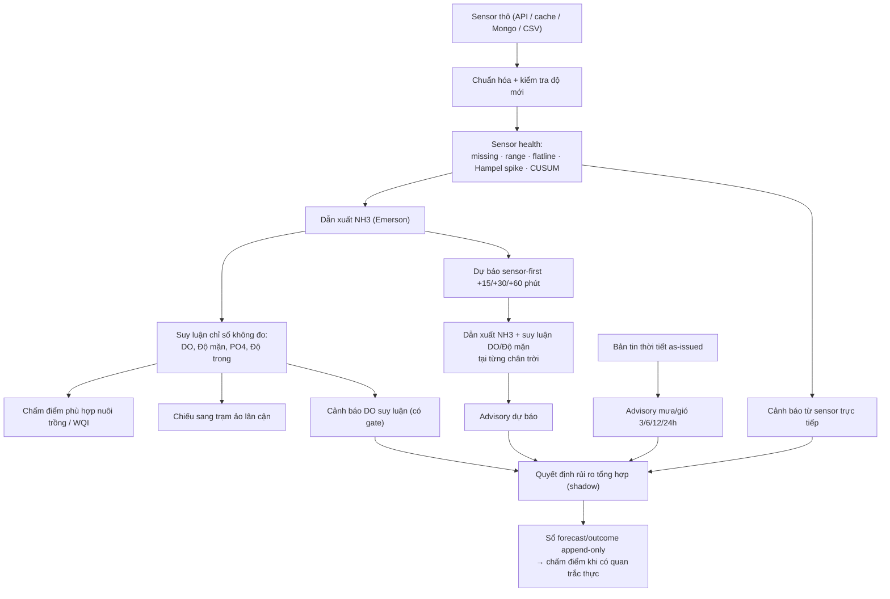
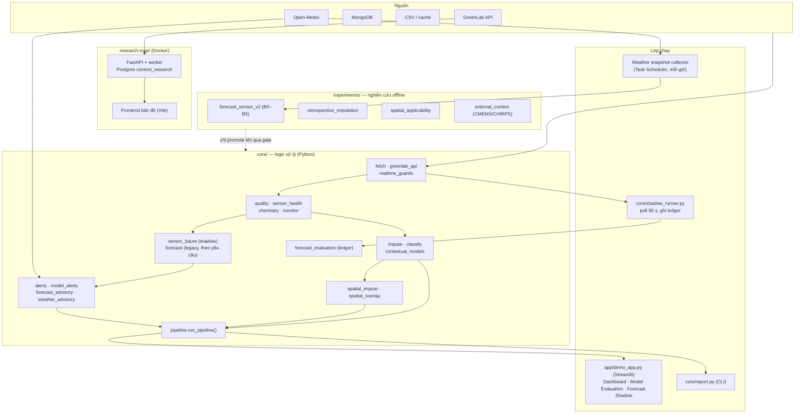
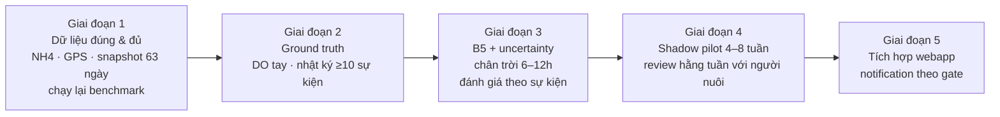

# Tổng quan dự án `lab-realtime` — Giám sát, dự báo và cảnh báo điều kiện nuôi cá lồng ven biển

> **Trạng thái tài liệu:** tổng hợp theo mã nguồn, artifact và guide hiện có đến 26/09/2026.
> Các con số kết quả đều trích từ artifact đã lưu trong `artifacts/experiments/` hoặc các guide 12, 15, 20;
> chỗ nào chưa có bằng chứng được ghi rõ là *chưa kiểm chứng*.
>
> **Phạm vi:** nhánh nghiên cứu `lab-realtime/`. Entrypoint vận hành chính của repo vẫn là `webapp/`.

## Mục lục

1. [Bài toán](#1-bài-toán)
2. [Nguồn dữ liệu](#2-nguồn-dữ-liệu)
3. [Mô hình hóa bài toán: đầu vào – xử lý – đầu ra](#3-mô-hình-hóa-bài-toán-đầu-vào--xử-lý--đầu-ra)
4. [Giải pháp hiện tại: kiến trúc xử lý](#4-giải-pháp-hiện-tại-kiến-trúc-xử-lý)
5. [Kết quả đạt được và đánh giá hiện trạng](#5-kết-quả-đạt-được-và-đánh-giá-hiện-trạng)
6. [Tiềm năng và hướng mở rộng nghiên cứu](#6-tiềm-năng-và-hướng-mở-rộng-nghiên-cứu)
7. [Phụ lục: bản đồ mã nguồn và tài liệu liên quan](#7-phụ-lục-bản-đồ-mã-nguồn-và-tài-liệu-liên-quan)

Thứ tự trình bày đi từ *vì sao* (bài toán) → *có gì trong tay* (dữ liệu) → *định nghĩa đầu vào/đầu ra* → *đã xây gì* (kiến trúc) → *đã chứng minh được đến đâu* (đánh giá) → *đi tiếp đâu* (mở rộng). Dữ liệu được đặt trước mô hình bài toán vì đầu vào của pipeline chỉ hiểu được khi đã biết từng nguồn có độ phân giải, độ phủ và độ tin cậy ra sao.

---

## 1. Bài toán

### 1.1 Bối cảnh

Nuôi cá lồng bè ven biển (đối tượng pilot: **cá giò — cobia**, tại làng bè Cát Bà, Hải Phòng) chịu rủi ro từ biến động chất lượng nước (oxy hòa tan DO thấp, nhiệt độ cao, NH3 độc, độ đục TSS) và điều kiện thời tiết (mưa lớn làm giảm độ mặn và phân tầng nước, gió mạnh gây xáo trộn đáy và stress cơ học). Người nuôi cần biết sớm *khi nào phải kiểm tra lồng* thay vì chỉ thấy một giá trị đo hay một nhãn "phù hợp/không phù hợp".

Hệ thống quan trắc GreenLab (dự án Đại học Thái Bình) đặt các trạm sensor đo tự động **5 chỉ số: COD, NH4, pH, Nhiệt độ, TSS** với chu kỳ khoảng 1 phút. Thiết bị **không đo DO và độ mặn** — hai chỉ số quan trọng nhất cho an toàn cá.

### 1.2 Câu hỏi vận hành

| Câu hỏi | Bài toán kỹ thuật tương ứng |
| --- | --- |
| Hiện tại nước tại lồng ra sao? | Thu nhận + kiểm soát chất lượng sensor + bổ sung chỉ số không đo được (DO, độ mặn, NH3) + chấm điểm phù hợp nuôi trồng |
| Sắp tới (15 phút – vài giờ) có nguy cơ gì? | Dự báo ngắn hạn chuỗi sensor, sau đó suy ra các chỉ số phụ thuộc tại từng chân trời |
| Thời tiết sắp tới có đáng lo không? | Thu bản tin dự báo khí tượng/hải dương và chuyển thành ngữ cảnh rủi ro |
| Kết quả tại trạm có áp dụng được cho vùng xung quanh không? | Đánh giá độ tin cậy khi ngoại suy không gian (*spatial applicability*) |
| Nên làm gì? | Hợp nhất thành mức cảnh báo có lý do, độ tin cậy và khuyến nghị kiểm tra |

### 1.3 Phát biểu bài toán

> Từ chuỗi quan trắc sensor gần-thời-gian-thực tại một trạm, dữ liệu quan trắc lịch sử theo quý của vùng, và bản tin thời tiết/hải dương bên ngoài, xây dựng hệ thống **(i)** ước lượng đầy đủ trạng thái chất lượng nước tại trạm, **(ii)** dự báo trạng thái đó ở chân trời ngắn, **(iii)** phát cảnh báo rủi ro nuôi trồng có giải thích và có giới hạn an toàn, và **(iv)** lượng hóa mức độ áp dụng kết quả ra không gian xung quanh — trong đó mọi kết luận phải truy ngược được về nguồn dữ liệu và chỉ được nâng lên vận hành khi có bằng chứng đánh giá tương ứng.

### 1.4 Ràng buộc đặc thù

- **Chỉ một trạm sống thực sự:** `06M26042804` (Đại học Thái Bình 1, Cát Bà). Ba trạm còn lại trong registry chưa có dữ liệu hoặc ngoài phạm vi (nước nội địa Hưng Yên).
- **DO và độ mặn không được đo** → chỉ có thể *suy luận*, và suy luận không bao giờ được coi là bằng chứng cho cảnh báo khẩn cấp.
- **Đơn vị NH4 chưa được nhà cung cấp xác nhận** (đang giả định µg/L, ×0.001 → mg/L), kéo theo NH3 và mọi mô hình dùng NH3 ở trạng thái "chờ xác nhận".
- **Chưa có ground truth thực địa** (DO đo tay, nhật ký sự kiện) để chấm hiệu quả cảnh báo.
- **Dữ liệu lịch sử khác cadence với sensor:** lịch sử theo quý/trạm, sensor theo phút.

---

## 2. Nguồn dữ liệu

Hệ thống dùng bốn nhóm nguồn với vai trò và loại bằng chứng khác nhau. Nguyên tắc chung: mỗi bản ghi giữ provenance (nguồn, thời điểm quan trắc, thời điểm nhận, đơn vị, trạng thái QC) và **không nguồn nào được dùng ngoài vai trò đã khai báo**.



### 2.1 Dữ liệu quan trắc lịch sử theo quý (2020–2024)

Quan trắc môi trường định kỳ của các tỉnh, đã làm sạch trong `data/<vùng>/clean_data.csv` (ngoài `lab-realtime/`, chỉ đọc).

| Vùng | File | Quy mô | Giai đoạn | Chỉ số chính |
| --- | --- | --- | --- | --- |
| Hải Phòng | `data/haiphong/clean_data.csv` | 216 dòng, 14 trạm, 22 mốc quý | 08/2020 – 11/2024 | DO, Nhiệt độ, pH, Độ mặn, NH3, PO4, TSS, Coliform, kim loại nặng (As, Cd, Pb, Cu, Zn, Cr), tọa độ X/Y |
| Quảng Ninh | `data/quangninh/clean_data.csv` | 1.584 dòng, 99 trạm, 16 mốc quý | 01/2021 – 10/2024 | Như trên + Độ trong, COD, CN, Hg, H2S, BOD5, Độ kiềm |
| Hưng Yên | `data/hungyen/clean_data.csv` | 1.584 dòng, 16 mốc quý | 01/2021 – 10/2024 | Tương tự Quảng Ninh |

**Vai trò:**

- Huấn luyện mô hình suy luận (imputation) các chỉ số sensor không đo (DO, Độ mặn, PO4, Độ trong) từ các chỉ số sensor đo được.
- Tính median theo vùng/trạm làm giá trị mặc định có đánh dấu `defaulted`.
- Benchmark không gian (sai số khi lấy trạm neo đại diện cho trạm khác theo khoảng cách).

**Lưu ý chất lượng:**

- Tọa độ VN-2000 dùng kinh tuyến trục theo tỉnh (HP 105°45', QN 107°45'); file cũ `haiphong_exogenous.csv` bị lệch kinh độ nên không còn dùng.
- `data-gen`, `data-v3`, `data-v4` là dữ liệu tổng hợp/gán nhãn lại theo luật → **bị loại có chủ ý** khỏi huấn luyện và đánh giá; chỉ dùng cho stress test thiếu dữ liệu/OOD.
- Một số chỉ số (BOD5, Độ kiềm tại QN; COD tương quan tất định) là artifact của dữ liệu → bị từ chối làm target.
- Ngưỡng nguy cơ `DO ≤ 5 mg/L` **không xuất hiện** trong tập test lịch sử → không đo được recall cho sự kiện DO thấp.

### 2.2 Dữ liệu sensor trực tiếp (GreenLab)

| Thuộc tính | Giá trị |
| --- | --- |
| Trạm sống | `06M26042804` — làng bè anh Toàn, Cát Bà, Hải Phòng (vùng nước ven biển) |
| Chỉ số | COD, NH4, pH, Temperature, TSS |
| Chu kỳ | ~1 phút (registry khai báo `expected_cadence_minutes: 1`, `max_staleness_minutes: 10`) |
| Giai đoạn | từ 29/05/2026; cache đã kiểm tra có **80.670 timestamp** đến 04/09/2026 23:05:55 UTC, có khoảng trống |
| Tọa độ lắp đặt | chưa khảo sát GPS; dùng trạm lịch sử **NB1 (cảng cá Cát Bà)** làm điểm tham chiếu bản đồ và thời tiết |

**Các kênh thu và thứ tự fallback** (`core/fetch.py`, `core/greenlab_api.py`):

1. **GreenLab API** `Datums/LastestDataByDevice` (có xác thực) → mỗi lần gọi được nối vào **cache append-only** cục bộ (`data/greenlab/exports/live-cache`).
2. **MongoDB Atlas** — collection snapshot `greenlab_latest_snapshot` (đợt kiểm kê 26/09: `query_empty`).
3. **CSV export** `data/greenlab/greenlab_export.csv` — 15.475 timestamp (29/05–19/06/2026), dùng cho demo offline (`USE_LOCAL_CSV=true`).
4. Nếu cả API và Mongo lỗi: dùng cache cũ, gắn nhãn `greenlab_api_cache_stale` và cảnh báo.

**Các vấn đề dữ liệu đã phát hiện:**

- Chuỗi thời gian trộn định dạng có/không mili giây → artifact hợp nhất vòng 2 có 96.144 timestamp nhưng parser chỉ đọc được 80.670. Vòng 3 đã thêm audit parse, duplicate, gap (`artifacts/experiments/weather-risk-pilot/round3/`).
- Một timestamp ≠ một mẫu độc lập; 5 chỉ số trong cùng timestamp không được cộng thành 5 mẫu.
- COD từng có giai đoạn "chết" (giá trị kẹt) → mô hình suy luận có hai bộ đặc trưng 4-biến/5-biến tùy trạng thái COD.
- NH4/COD tại trạm rất cao so với QCVN → có thể ô nhiễm cục bộ hoặc sai đơn vị; chưa kết luận được.

### 2.3 Nguồn bên ngoài

| Nguồn | Nội dung | Cách dùng hiện tại | Loại bằng chứng |
| --- | --- | --- | --- |
| **Open-Meteo Forecast** | Nhiệt độ không khí, độ ẩm, mưa, mây, áp suất, gió (theo giờ, 3 ngày) | Gắn vào payload realtime (cache 60 phút); rule advisory mưa/gió; collector lưu snapshot "as-issued" mỗi giờ từ 01/08/2026 | Ngữ cảnh vận hành; dữ liệu B5 đang tích lũy |
| **Open-Meteo Marine** | Sóng, dòng chảy, mực nước, nhiệt độ mặt biển | Ngữ cảnh điểm, tách riêng để lớp thiếu không thành giá trị 0 | Hiển thị |
| **Open-Meteo lịch sử** | Thời tiết quan trắc quá khứ | Nghiên cứu weather-lag (mưa/gió tích lũy 1–24h) | Thăm dò (`exploratory_only`) |
| **Copernicus CMEMS / GLORYS** | Tái phân tích hải dương (độ mặn, nhiệt độ, dòng chảy…) | Thí nghiệm tái dựng DO/Độ mặn lịch sử; lớp tùy chọn trong research-map | Hồi cứu, không dùng realtime |
| **CHIRPS v3** | Mưa tháng/ngày vệ tinh | Mưa tiền kỳ (trễ 2 ngày) cho thí nghiệm hồi cứu | Hồi cứu |
| **GEBCO** | Độ sâu đáy biển | Lớp bản đồ trong research-map | Hiển thị/ngữ cảnh |
| **OSM water polygons** | Ranh giới mặt nước | Cắt các vùng/vòng bản đồ để không vẽ lên đất liền | Hình học |

**Nguyên tắc chống rò rỉ thời gian:** chỉ bản tin có `retrieved_at ≤ forecast_origin` mới được dùng cho mô hình. Thời tiết quan trắc quá khứ, CHIRPS, GLORYS chỉ là bằng chứng *hồi cứu/thăm dò*, không được dùng để chọn mô hình thời tiết cho vận hành.

### 2.4 Ground truth thực địa (đã thiết kế, chưa có dữ liệu)

- **Mẫu lab / DO đo tay** cùng vị trí, cùng thời điểm với sensor — công cụ ghép lab–sensor có tolerance và kiểm tra đơn vị đã có (`experiments/prepare_ground_truth_dataset.py`, guide 09).
- **Nhật ký thực địa** theo mẫu `docs/guide/field_event_template.md`: thời gian, vị trí, DO đo, dấu hiệu cá (bỏ ăn, nổi đầu), thời tiết tại chỗ, hành động xử lý (sục khí, thay nước), người xác nhận, ID quyết định của hệ thống.
- Đề xuất nghiệm thu pilot khi có **≥ 10 sự kiện** ghi nhận; lấy mẫu cả theo lịch cố định (lúc bình thường) để tránh thiên lệch "chỉ kiểm tra nơi hệ thống đã báo".

---

## 3. Mô hình hóa bài toán: đầu vào – xử lý – đầu ra

### 3.1 Đầu vào

| Nhóm | Biến | Tần suất | Ghi chú |
| --- | --- | --- | --- |
| Sensor đo trực tiếp | `pH`, `Temperature`, `NH4`, `TSS`, `COD` | ~1 phút | Có QC, độ mới (`fresh/stale/missing`) |
| Biến dẫn xuất | `NH3` = f(NH4, pH, Nhiệt độ) | theo sensor | Cân bằng Emerson (1975): pKa = 0.09018 + 2729.92/T(K); f = 1/(1+10^(pKa−pH)) |
| Thời tiết dự báo | mưa, gió, nhiệt độ không khí, mây, áp suất; sóng/dòng chảy | theo giờ | Kèm `retrieved_at`, `valid_at`, tọa độ, provider |
| Lịch | tháng, sin/cos tháng, giờ trong ngày | — | Chỉ giữ khi ablation chứng minh có ích |
| Tri thức tĩnh | ngưỡng QCVN 10, profile cá giò `cobia-v1-provisional`, tiêu chí phù hợp nuôi trồng | — | Ngưỡng có phiên bản, đánh dấu *provisional* |
| Mô hình huấn luyện sẵn | bundle `.pkl` + `feat_cols.json`, `cv_r2.json`, `regional_medians.json`, manifest | — | Huấn luyện offline từ §2.1 và §2.2 |

### 3.2 Chuỗi xử lý (khái niệm)



### 3.3 Đầu ra

| Đầu ra | Nội dung | Ai dùng |
| --- | --- | --- |
| `measured_params` + `freshness` | Giá trị đo mới nhất, trạng thái dữ liệu | Dashboard |
| `anchor_classification` | Bộ tham số đầy đủ chia `measured / imputed / defaulted`, điểm và nhãn phù hợp, tỷ lệ tham số không đo trực tiếp, confidence (`strong/weak` theo CV R²) | Dashboard, báo cáo CLI |
| `virtual_stations` | Giá trị chiếu sang các trạm lịch sử Hải Phòng, `imputed_by` (mô hình hay median), WQI | Bản đồ demo |
| `sensor_future` / `station_future` | Timeline +15/+30/+60 phút: sensor dự báo, NH3, DO/Độ mặn suy luận, nguồn mô hình | Dashboard tab Forecast Shadow |
| `aquaculture_alert` | `risk_score`, `severity` (NORMAL/WATCH/WARNING/EMERGENCY), `drivers`, `sensor_health`, khuyến nghị, vòng đời OPEN→RESOLVING→RESOLVED | Dashboard |
| `inferred_do_alert`, `forecast_advisory` | Cảnh báo/advisory từ DO suy luận và từ dự báo; luôn `used_by_emergency=false` | Dashboard |
| `weather`, `environment`, `weather_advisory` | Bản tin theo giờ, tổng hợp cửa sổ, mức WATCH và lý do | Dashboard |
| Ledger (`forecast_evaluation`, `risk_decisions.jsonl`) | Dự báo lúc phát hành + kết quả thực tế ghép ±4 phút, MAE/RMSE/bias theo chân trời | Đánh giá shadow |
| Bản đồ không gian | Overlay vùng tin cậy đã qua gate (hiện chỉ Độ mặn 5–10 km quanh NB1, `research_shadow_only`) | Research map |

### 3.4 Các ràng buộc an toàn gắn vào đầu ra

- `EMERGENCY` chỉ phát được từ **DO đo trực tiếp, QC hợp lệ**. Hiện không có sensor DO → hệ thống không bao giờ phát EMERGENCY.
- DO suy luận/dự báo bị chặn ở mức tối đa `WARNING` (forecast advisory) hoặc `CRITICAL_ADVISORY` (lời khuyên kiểm tra lồng, chuẩn bị sục khí — không phải khẩn cấp).
- Dữ liệu `stale/missing` → toàn bộ dự báo và cảnh báo nước chuyển `BLOCKED` kèm lý do; thời tiết vẫn hiển thị như ngữ cảnh.
- Mô hình contextual DO/Độ mặn chỉ chạy khi `NH4_CONVERSION_CONFIRMED=true` và đặc trưng nằm trong miền huấn luyện; ngoài miền → `rejected`, không fallback ngầm.
- "Bình thường" chỉ được kết luận khi mọi nguồn bắt buộc đầy đủ và còn hạn; mất một nguồn không xóa cảnh báo đang có bằng chứng.

---

## 4. Giải pháp hiện tại: kiến trúc xử lý

### 4.1 Kiến trúc tổng thể

Hệ thống gồm ba lớp chạy, một lớp nghiên cứu và một ứng dụng bản đồ độc lập:



### 4.2 Các khối chức năng

#### a) Thu nhận và bảo vệ dữ liệu

- `fetch.py` chọn nguồn theo cấu hình (`GREENLAB_FETCH_MODE`, `USE_LOCAL_CSV`) và fallback có nhãn `data_source` + `data_warning`.
- `greenlab_api.py` pivot bản ghi dạng long thành một dòng/timestamp, đổi tên `Temp → Temperature`, nối vào cache append-only.
- `realtime_guards.py` đánh giá độ mới theo `max_staleness_minutes`; chế độ `replay` cho demo không phát hành dự báo.

#### b) Kiểm soát chất lượng sensor

- `quality.py`: lọc dải vật lý hợp lý, gộp median theo ngày, trạng thái COD.
- `sensor_health.py`: phát hiện missing, gap, ngoài dải, **flatline** (≥10 giá trị giống nhau), **Hampel spike** (cửa sổ 15, k=3.5, nhân quả), **CUSUM** level shift. Dữ liệu `suspect/invalid` không được dùng để nâng mức cảnh báo.
- `monitor.py`: đối chiếu QCVN 10 (B1) cho báo cáo.

#### c) Suy luận chỉ số không đo (local imputation)

- `impute.py`: mỗi vùng hai bộ XGBoost thích nghi theo COD — **5 đặc trưng** `[COD, NH3, pH, Temperature, TSS]` khi COD sống, **4 đặc trưng** khi COD chết. Thêm `month` hoặc `sin/cos(month)` cho các target đã chứng minh có lợi.
- Target có CV R² thấp hoặc là artifact (kim loại nặng, Coliform, H2S…) không được suy luận mà lấy **median vùng** và đánh dấu `defaulted`.
- `contextual_models.py`: bundle mới **ExtraTrees** cho Hải Phòng (`hp-contextual-v1-shadow`): DO từ `NH3, pH, Temperature, TSS`; Độ mặn thêm `month`. Có gate đơn vị NH4, gate miền đặc trưng (OOD).
- `classify.py`: hợp nhất `measured > imputed > defaulted`, gọi `src.classification._classify_by_scoring` (dùng chung với webapp) để chấm điểm phù hợp cho loài nuôi.

#### d) Ngoại suy không gian

- `spatial_impute.py` (legacy demo): dùng vector tham số tại trạm neo để dự đoán một số biến cho các trạm lịch sử Hải Phòng, phần còn lại lấy median trạm; chấm lại WQI cho từng trạm ảo.
- `spatial_overlay.py` + `experiments/spatial_applicability.py` (hướng mới): thay vì "bán kính đúng/sai", ước lượng **cận sai số p90 theo khoảng cách** + hiệu chỉnh **split-conformal**, đánh giá bằng *forward temporal* và *leave-target-station-out*. Chỉ tổ hợp (biến × khoảng cách × mức coverage) qua gate Wilson-95% ở cả hai protocol mới được vẽ, phần còn lại `not_applicable`.

#### e) Dự báo ngắn hạn

- **Sensor-first (đang dùng trong shadow)** — `sensor_future.py`: dự báo các sensor đo được trước, rồi mới suy luận các chỉ số phụ thuộc tại từng chân trời:
  - Nhiệt độ: XGBoost + đặc trưng thời gian, 3 bundle 15/30/60 phút.
  - TSS: XGBoost theo cadence gốc; fallback persistence nếu thiếu bundle hoặc 10 bản ghi cuối trải dài hơn 30 phút (không "bắc cầu" qua khoảng mất dữ liệu).
  - pH, NH4: **persistence** (không mô hình nào thắng baseline).
  - Sau đó: NH3 (Emerson) → DO/Độ mặn contextual.
- **Legacy** — `forecast.py`: XGBoost đệ quy theo vùng × granularity (phút/giờ/ngày) × chỉ số; chỉ chạy khi yêu cầu vì phải replay toàn bộ lịch sử. Nhược điểm: dự báo DO trên chuỗi DO *nội suy*.
- **Benchmark v2** — `experiments/forecast_sensor_v2.py`: direct forecasting, 5 fold rolling-origin + **lockbox 14 ngày** chưa chạm; thang đặc trưng **B0** lags → **B1** + lịch → **B2** động học → **B3** chéo sensor → **B4** chất lượng → **B5** + bản tin thời tiết as-issued.

#### f) Cảnh báo và advisory (hybrid ML + luật)

| Lớp | Module | Logic | Mức tối đa |
| --- | --- | --- | --- |
| Sensor trực tiếp | `alerts.py` | Ngưỡng DO/nhiệt độ/NH3 theo profile cá giò, tốc độ giảm DO 15 phút, tổ hợp DO+nhiệt độ; điểm 0–100 → NORMAL/WATCH/WARNING/EMERGENCY | EMERGENCY (chỉ với DO đo trực tiếp) |
| DO suy luận | `model_alerts.py` | DO ≤ 5 → WATCH; ≤ 4 lặp 2 chu kỳ hoặc kèm Nhiệt độ ≥ 31 °C / NH3 ≥ 0.05 → WARNING; ≤ 3 lặp + stress kép → CRITICAL_ADVISORY; OOD/stale → BLOCKED | CRITICAL_ADVISORY |
| Dự báo | `forecast_advisory.py` | DO dự báo ≤ 5 → WATCH; ≤ 4 hoặc Nhiệt độ dự báo ≥ 33 °C → WARNING | WARNING, không gửi thông báo |
| Thời tiết | `weather_advisory.py` | Cửa sổ 3/6/12/24h phải đủ giờ; mưa ≥ 10 mm/6h hoặc gió cực đại ≥ 35 km/h → WATCH | WATCH |
| Tổng hợp | `shadow_runner.py` | Lấy mức cao nhất giữa nước và thời tiết; NORMAL chỉ khi đủ nguồn | Ghi file, không gửi |

#### g) Đánh giá shadow

- `forecast_evaluation.py` ghi mỗi dự báo **tại thời điểm phát hành** (kèm provenance thời tiết, advisory) vào ledger append-only; khi có quan trắc thật thì ghép ±4 phút và tính MAE/RMSE/bias theo chân trời/mô hình. Chỉ chấm sensor đo trực tiếp; DO/Độ mặn chờ ground truth độc lập.
- `shadow_runner.py` chạy tách khỏi dashboard, poll 60 giây, có `--once`; ID quyết định băm từ (trạm, thời điểm, phiên bản policy) để idempotent.

#### h) Giao diện

- **Streamlit** `app/demo_app.py`: 3 tab — *Dashboard* (trạm gốc, trạm ảo, bản đồ Folium, cảnh báo), *Model Evaluation* (backtest), *Forecast Shadow* (timeline + metric ledger).
- **CLI** `core/report.py --station 06M26042804`: báo cáo QCVN, phân loại, cảnh báo imputation.
- **Research map** `research-map/` (Docker: FastAPI `:8010`, frontend `:8083`, Postgres riêng): worker lưu snapshot ngữ cảnh môi trường mỗi 30 phút trên lưới ~1 km cắt theo mặt nước (gió, sóng, dòng chảy, mưa, mực nước), poll sensor 60 giây, endpoint `/stations/{serial}/context` trả `model_input_status=blocked` nếu một phía không còn mới; lớp Copernicus/GEBCO tùy chọn; streamline dòng chảy có LOD theo zoom. Ứng dụng chỉ *đọc* HSI và không thay đổi cảnh báo.

---

## 5. Kết quả đạt được và đánh giá hiện trạng

### 5.1 Kết quả định lượng chính

**Suy luận chỉ số lịch sử (guide 12, hồi cứu theo quý):**

| Vùng / target | Kết luận | Mô hình | Bằng chứng |
| --- | --- | --- | --- |
| HP / DO | contextual retrospective | ExtraTrees | Temporal RMSE 0.253 (R² 0.58); station-holdout RMSE 0.236 (R² 0.62); thắng median, Ridge, XGBoost |
| HP / Độ mặn | contextual retrospective | ExtraTrees + month | Thêm `month`: temporal R² −0.18 → 0.46; station R² 0.69 → 0.88 |
| QN / Độ mặn | contextual retrospective | Ridge | — |
| QN / Độ trong | contextual retrospective | ExtraTrees | — |
| HP, QN / PO4; QN / DO | giữ median | — | Mô hình không thắng median ổn định (QN/DO XGBoost temporal R² −188) |
| QN / BOD5, Độ kiềm | loại | — | Artifact dữ liệu |

**Dự báo sensor Hải Phòng (guide 15, chuỗi 80.664 timestamp 29/05–26/07, holdout 20%):**

| Sensor | 15 phút MAE | 30 phút MAE | 60 phút MAE | Chọn |
| --- | --- | --- | --- | --- |
| Nhiệt độ — persistence / XGBoost | 0.182 / **0.150** | 0.189 / **0.158** | 0.207 / **0.181** | XGBoost + thời gian |
| TSS — persistence / XGBoost | 17.46 / **16.77** | 19.87 / **18.21** | 22.41 / **20.40** | XGBoost cadence gốc |
| pH, NH4 | persistence thắng | | | Persistence |

Benchmark v2 (Ridge + lags + lịch, lockbox 14 ngày): MAE nhiệt độ giảm **20,0% / 18,6% / 17,4%** so với persistence ở 15/30/60 phút. *Kết quả này có trước bản sửa chuẩn hóa timestamp — cần chạy lại để tái xác nhận.*

**Thời tiết (thăm dò):**

- Weather-lag theo giờ tại NB1: mưa/gió tích lũy cải thiện **NH4** ở 1/3/6h; TSS cải thiện không ổn định; **xấu đi** với Nhiệt độ, pH.
- Ablation NB1 theo quý: thời tiết cải thiện R² Độ mặn ở 9/9 cặp (+0.94 trung bình), DO 6/9 cặp — nhưng dùng thời tiết quan trắc, mẫu < 30 cặp.
- CMEMS: tín hiệu mạnh cho **Độ mặn** (station-holdout RMSE 0.387 → 0.091), nhưng **làm xấu** DO theo thời gian (0.253 → 0.333) → không dùng cho DO.
- **B5 (sensor + bản tin as-issued): chưa có kết luận.** Số cặp nhân quả hợp lệ hiện là 0 do sensor và snapshot thời tiết gần như không chồng thời gian; cần ~63 ngày snapshot liên tục.

**Không gian (guide 20):**

- Anchor-copy Hải Phòng: sai số DO gần như không tăng theo khoảng cách (MAE 0.18–0.22) — nhiều khả năng do DO lịch sử ít biến động hơn là do tính đại diện cao; Độ mặn tăng rõ (0.04 ở 2–5 km → 0.47 ở >20 km).
- Quảng Ninh: recall nguy cơ độ mặn thấp sụp từ 0.82 (5–10 km) xuống 0.06 (10–20 km) → không thể dùng một bán kính chung.
- Bound conformal 90%: coverage 90,0–98,9% tổng thể, nhưng một số bin không đạt (Độ mặn >20 km chỉ 65,7%). Trong 36 tổ hợp chỉ **1** (Độ mặn 5–10 km, coverage 80/90%) đạt `shadow_candidate`.
- Quy tắc bán kính HSI cũ (`aqua-forecast`) cho "100% cùng nhãn" nhưng là **rò rỉ** (đọc HSI của trạm đích) → bị cấm trong runtime.

**Kỹ thuật:** 37 file `test_*.py` trong `tests/`; các đợt gần nhất ghi nhận 61 → 83 test pass (07/2026) và 21/21 test của pipeline thời tiết vòng 3 (09/2026).

### 5.2 Điểm mạnh

1. **Kỷ luật bằng chứng rõ ràng.** Mọi đầu ra phân tầng `measured / imputed / defaulted / inferred / forecast` và gắn `used_by_alerts`, `used_by_emergency`, `notification_eligible`. Đây là điểm khác biệt chính so với các hệ thống "WQI realtime" thông thường vốn trộn giá trị đo với giá trị mô hình.
2. **Thiết kế đánh giá đúng chuẩn chuỗi thời gian.** Đã thay random K-fold bằng temporal split, leave-station-out, rolling-origin + lockbox; có promotion gate (phải thắng baseline ở *cả* MAE và RMSE, *mọi* chân trời).
3. **Chống rò rỉ thời gian cho thời tiết.** Phân biệt `issued_at`, `retrieved_at`, `valid_at`; snapshot as-issued có hash, append-only; dữ liệu thời tiết hồi cứu bị gắn `exploratory_only`.
4. **Kiến trúc sensor-first hợp lý.** Dự báo đại lượng *đo được* rồi mới suy luận DO, thay vì dự báo chuỗi DO nội suy — tránh tích lũy sai số mô hình chồng mô hình.
5. **Chịu lỗi nguồn.** Fallback nhiều tầng có nhãn, trạng thái `BLOCKED/degraded` minh bạch, không điền 0 khi thiếu.
6. **Tái lập được.** Mỗi run có manifest, hash dữ liệu đầu vào, artifact theo `run_id`.
7. **Trung thực với kết quả âm.** Ghi nhận rõ pH/NH4 không thắng persistence, QN/DO bị loại, B5 chưa có bằng chứng, quy tắc HSI cũ bị rò rỉ.

### 5.3 Hạn chế và rủi ro

| # | Vấn đề | Mức độ | Hệ quả |
| --- | --- | --- | --- |
| 1 | Chỉ một trạm sống, chưa có GPS lắp đặt (dùng NB1 cảng cá làm tham chiếu) | Cao | Không kiểm chứng được tổng quát hóa; thời tiết lấy tại cảng có thể khác lồng ngoài khơi |
| 2 | Không có sensor DO, không có ground truth thực địa | Cao | Không thể đo recall/false alarm của cảnh báo — giá trị thực của hệ thống chưa được chứng minh |
| 3 | Đơn vị/cơ sở NH4 chưa xác nhận | Cao | NH3, mô hình contextual DO/Độ mặn và ngưỡng NH3 đều có thể lệch hệ thống; contextual bị tắt mặc định |
| 4 | Lệch miền giữa huấn luyện (quý, trạm quan trắc tỉnh) và suy luận (phút, sensor lồng bè) | Cao | Mô hình suy luận DO học quan hệ *giữa các quý*, không đảm bảo đúng ở biến động trong ngày |
| 5 | Dữ liệu sensor có gap, định dạng timestamp không đồng nhất | Trung bình | Kết quả benchmark trước vòng 3 cần chạy lại |
| 6 | B5 chưa có cặp sensor–bản tin chồng thời gian | Trung bình | Câu hỏi nghiên cứu chính ("thời tiết giúp cảnh báo sớm hơn?") chưa trả lời được |
| 7 | Ngưỡng cảnh báo (mưa 10 mm/6h, gió 35 km/h, DO 4/5, nhiệt 31/33 °C) đặt tay, profile `provisional` | Trung bình | Cần hiệu chỉnh với người nuôi/chuyên gia và dữ liệu sự kiện |
| 8 | Chưa có khoảng dự báo/uncertainty cho forecast sensor | Trung bình | Advisory không biểu đạt được độ chắc chắn |
| 9 | Hai nhánh song song cho cùng chức năng (forecast legacy vs sensor-first; spatial_impute legacy vs spatial applicability) | Thấp–TB | Dễ nhầm khi trình bày; legacy DO-forecast vẫn dựa trên DO nội suy |
| 10 | Chất lượng mã không đồng đều: ví dụ comment nháp còn sót trong `shadow_runner.record_risk_decision`; guide 01–05 viết trước giai đoạn shadow nên mô tả chưa đủ; risk log thiếu input IDs | Thấp | Cần dọn trước khi bàn giao/tích hợp `webapp/` |
| 11 | Lifecycle cảnh báo trong dashboard chỉ giữ trong session; chưa có event store, notification | Thấp (đúng chủ ý ở giai đoạn shadow) | Chưa vận hành thật được |

### 5.4 Đánh giá tổng thể

| Tầng | Mức hoàn thiện |
| --- | --- |
| Thu nhận, cache, fallback, QC sensor | **Đã có, chạy được** |
| Suy luận chỉ số + chấm điểm phù hợp | **Đã có**; độ chính xác chỉ có bằng chứng hồi cứu |
| Dự báo sensor ngắn hạn + ledger shadow | **Đã có**; Nhiệt độ/TSS thắng baseline, cần tái xác nhận sau chuẩn hóa |
| Thời tiết: hiển thị, advisory, lưu snapshot | **Chạy bước đầu**; collector có khoảng gián đoạn |
| Thời tiết vào mô hình (B5) | **Đang sửa** — đường ống chạy trên fixture, chưa có dữ liệu thật |
| Vùng tin cậy không gian | **Nghiên cứu P0–P1 xong**, chưa promote ngoài 1 overlay shadow |
| Đánh giá cảnh báo theo sự kiện thực địa | **Chưa có bằng chứng** |

Nói gọn: `lab-realtime` đã là một **nền tảng nghiên cứu shadow hoàn chỉnh về mặt kỹ thuật** — thu, kiểm, suy luận, dự báo, cảnh báo, ghi sổ và chấm điểm. Điều còn thiếu không nằm ở phần mềm mà ở **dữ liệu kiểm chứng**: DO thực, sự kiện thực địa, đơn vị NH4, và chuỗi bản tin thời tiết đủ dài trùng với sensor.

---

## 6. Tiềm năng và hướng mở rộng nghiên cứu

### 6.1 Tiềm năng ứng dụng

- **Hỗ trợ quyết định cho người nuôi lồng bè:** chuyển từ "hiển thị số" sang "khi nào cần kiểm tra/sục khí và vì sao", với chi phí phần cứng thấp (sensor 5 chỉ số giá rẻ + dữ liệu thời tiết miễn phí).
- **"Cảm biến mềm" (soft sensor) cho DO và độ mặn:** nếu được kiểm chứng, giảm nhu cầu lắp đầu đo DO đắt và cần bảo trì thường xuyên.
- **Khung an toàn cho AI trong cảnh báo môi trường:** mô hình evidence-gating (đo trực tiếp vs suy luận vs dự báo) có thể tái sử dụng cho các lĩnh vực quan trắc khác.
- **Tận dụng mạng quan trắc định kỳ của tỉnh** (hơn 100 trạm, 4–5 năm) làm tri thức nền cho các trạm sensor mới.

### 6.2 Hướng ưu tiên ngắn hạn (hoàn thiện pilot)

1. **Đóng vòng dữ liệu (P0):** xác nhận đơn vị NH4 với GreenLab; khảo sát GPS lồng; chạy collector thời tiết liên tục ≥ 63 ngày; chạy lại benchmark v2 trên dữ liệu đã chuẩn hóa.
2. **Ground truth tối thiểu:** DO đo tay theo lịch + khi có sự kiện, nhật ký thực địa; mục tiêu ≥ 10 sự kiện trước khi nghiệm thu.
3. **Đánh giá theo sự kiện thay vì chỉ MAE:** recall vùng nguy cơ, false alarm/tuần, lead time, alert burden.
4. **Dời trọng tâm sang chân trời 6–12 giờ** — đủ thời gian để người nuôi can thiệp; đây cũng là nơi thời tiết có khả năng đóng góp nhiều nhất (tín hiệu trễ của NH4/TSS).
5. **Uncertainty cho dự báo:** quantile/conformal interval (đã có kinh nghiệm conformal ở nhánh ARWS và spatial P1).

### 6.3 Hướng nghiên cứu mở rộng

| Hướng | Nội dung | Liên hệ với hiện trạng |
| --- | --- | --- |
| **Giá trị gia tăng của bản tin thời tiết (B5)** | So sánh sensor-only vs sensor + bản tin as-issued trên cùng origin; lag/rolling mưa–gió; xử lý thiếu thời tiết | Câu hỏi nghiên cứu trung tâm; hạ tầng đã có |
| **Phát hiện sự kiện thay vì hồi quy** | Dự báo xác suất `DO thấp`/`TSS tăng đột biến` trong N giờ tới (classification/survival), calibrate xác suất | Phù hợp hơn với nhu cầu cảnh báo; đề xuất trong slide 26/09 |
| **Soft sensor DO có hiệu chỉnh** | Hiệu chỉnh contextual DO với DO đo tay (domain adaptation từ dữ liệu quý sang phút), thêm biến chu kỳ ngày/đêm, cường độ quang hợp (bức xạ, mây) | Giải quyết hạn chế #4 |
| **Mô hình nền chuỗi thời gian** | So sánh zero-shot Chronos/TimesFM/Moirai với XGBoost/Ridge/persistence trên sensor phút | Repo đã có kinh nghiệm Chronos-Bolt, ARWS ở nhánh webapp/paper |
| **Vùng tin cậy không gian có calibration** | Thêm zone/thủy văn/độ sâu (GEBCO), khoảng cách theo đường nước, mùa; GAM/quantile GBM có ràng buộc đơn điệu; gộp bất định thời gian + không gian | Tiếp P1 → P2–P3 của guide 19 |
| **Ngữ cảnh hải dương realtime** | Dòng chảy, sóng, mực nước (Copernicus forecast, Open-Meteo marine), pha triều | CMEMS cho thấy tín hiệu mạnh với Độ mặn |
| **Mạng nhiều trạm** | Khi trạm Vân Đồn (QN) và các trạm khác có dữ liệu: học chuyển giao giữa trạm, mô hình đồ thị không gian–thời gian | Registry đã có 4 trạm |
| **Hiệu chỉnh ngưỡng theo dữ liệu** | Học ngưỡng/persistence/hysteresis tối ưu từ sự kiện; profile theo mùa, theo loài (cá giò, hàu…) | Ngưỡng hiện đặt tay, có phiên bản |
| **Giám sát sức khỏe sensor nâng cao** | Phân biệt lỗi thiết bị vs sự kiện môi trường thật; đo precision/recall và time-to-detect | `sensor_health.py` đã có nền |
| **Mô phỏng lan truyền** | Lan truyền dòng chảy/chất ô nhiễm quanh đảo (streamline đã có trong research-map) — chỉ sau khi có điều kiện biên, địa hình và dữ liệu kiểm định | Lớp hiển thị đã có, chưa có độ đúng thủy động lực |
| **Tích hợp vận hành** | Event/alert store bất biến, notification (Zalo/SMS) theo ma trận severity, retry/idempotency, đưa vào `webapp/` | Giai đoạn 6–7 của guide 08 |

### 6.4 Liên hệ nghiên cứu gần đây (2026)

**[1] Ghaderi, D. (2026).** *Multi-criteria evaluation of suitable sites for marine cage aquaculture in southern Iran based on oceanographic and environmental factors.* Regional Studies in Marine Science, 101, 105287. doi:10.1016/j.rsma.2026.105287

- **Nội dung:** đánh giá mức phù hợp của vùng biển miền Nam Iran (vịnh Ba Tư, eo Hormuz, vịnh Oman) cho lồng nuôi xa bờ bằng fuzzy logic + ra quyết định đa tiêu chí (MCDA). Tiêu chí gồm các yếu tố môi trường, hải dương và thủy động lực. Đối tượng là **cá giò (*Rachycentron canadum*)**, cá chẽm và cá mú chấm cam. So sánh trọng số đều với trọng số do chuyên gia gán.
- **Mở rộng cho dự án:**
  1. Thay ngưỡng cứng trong chấm điểm phù hợp bằng **hàm thành viên fuzzy**, để giá trị nằm gần ngưỡng không làm nhãn nhảy đột ngột — đúng điểm yếu đã gặp với quy tắc bán kính HSI cũ.
  2. **Phân tích độ nhạy trọng số** (đều vs chuyên gia) cho bộ tiêu chí cá giò hiện có.
  3. Bổ sung tiêu chí **thủy động lực**: dòng chảy, sóng, độ sâu — dữ liệu CMEMS và GEBCO đã có trong `research-map`.
  4. Ghép **điểm phù hợp + vùng tin cậy không gian** thành bản đồ quy hoạch có độ tin cậy.
- **Khác biệt cần lưu ý:** bài báo giải bài toán chọn vị trí dài hạn, gần như tĩnh. `lab-realtime` giải bài toán vận hành ngắn hạn tại lồng đang nuôi. Hai lớp này bổ trợ cho nhau, không thay thế nhau.

**[2] Martina, T., Saad, M., Rucco, C., Longo, A. (2026).** *Empirical evaluation of LLMs capabilities for data pipeline generation on Databricks platform.* Future Generation Computer Systems, 108587. doi:10.1016/j.future.2026.108587

- **Nội dung:** đánh giá 7 LLM (họ GPT-5, Claude 4, Qwen3) trong việc sinh pipeline ETL PySpark trên Databricks, qua 3 kịch bản: kiểm tra chất lượng dữ liệu, gộp theo thời gian, tích hợp đa nguồn. Thước đo là số lần LLM phải tự sửa lỗi (*fix-count*). Claude Opus 4 và GPT-5 mini ổn định nhất; điểm phong cách code (Pylint) không phản ánh tính đúng chức năng.
- **Mở rộng cho dự án:**
  1. Ba kịch bản của bài báo **trùng với pipeline dữ liệu** của dự án: QC sensor, gộp phút/giờ, ghép sensor với snapshot thời tiết.
  2. LLM có thể tăng tốc viết ETL, nhưng phải đi kèm **test tích hợp và kiểm tra rò rỉ thời gian**. Bài học từ vòng 3 (`docs/guide/26-...`): lỗi ghép B5 và lỗi parse timestamp chỉ lộ ra khi có test đầu-cuối.
  3. Có thể đo *fix-count* trên chính các kịch bản ETL của dự án để chọn công cụ hỗ trợ.
  4. Spark/Databricks chỉ đáng dùng khi **mở rộng ra nhiều trạm**; với ~80 nghìn timestamp hiện tại, pandas là đủ.
- **Mức liên quan:** gián tiếp — thuộc mảng kỹ thuật dữ liệu, không phải mô hình môi trường.

### 6.5 Lộ trình đề xuất



Điều kiện chuyển giai đoạn: mỗi thành phần chỉ được nâng từ *shadow/research* lên *vận hành* khi vượt baseline, ổn định qua các split, đã calibrate, có cổng OOD/reject và được chuyên gia chấp nhận phạm vi sử dụng.

---

## 7. Phụ lục: bản đồ mã nguồn và tài liệu liên quan

### 7.1 Thư mục

| Đường dẫn | Vai trò |
| --- | --- |
| `core/` | Logic xử lý runtime (fetch, QC, impute, classify, forecast, alerts, ledger, pipeline) |
| `core/models/` | Bundle imputation theo vùng (4/5 đặc trưng), contextual HP, `cv_r2.json`, `feat_cols.json`, `regional_medians.json` |
| `core/models/forecast/` | Bundle forecast legacy theo vùng × granularity × chỉ số |
| `core/models/sensor_future/` | Bundle sensor-first: Nhiệt độ, TSS × 15/30/60 phút |
| `app/` | Streamlit demo |
| `experiments/` | Script benchmark và `output/` artifact theo run |
| `research-map/` | Ứng dụng bản đồ ngữ cảnh môi trường (FastAPI + frontend + worker) |
| `tests/` | Test đơn vị/tích hợp |
| `docs/guide/` | Guide chi tiết (01–26) |
| `docs/slides/progress-2026-09-26/` | Slide HTML báo cáo tiến độ |
| `ingest/` (gốc repo) | `stations.yaml`, CSV export, cache API, script crawler |

### 7.2 Lệnh chạy nhanh

```powershell
# Báo cáo CLI cho trạm pilot
python core/report.py --station 06M26042804

# Dashboard demo (dùng CSV khi không có Mongo/API)
$env:USE_LOCAL_CSV = "true"
streamlit run app/demo_app.py

# Shadow runner một lần
python core/shadow_runner.py --once

# Benchmark dự báo sensor v2
python experiments/forecast_sensor_v2.py data/greenlab/greenlab_export.csv `
  --station 06M26042804 --output artifacts/experiments/forecast-v2/run-001

# Test
python -m pytest tests -q
```

### 7.3 Guide chi tiết theo chủ đề

| Chủ đề | Guide |
| --- | --- |
| Tổng quan, đầu vào/ra, luồng xử lý (bản đầu) | 01, 03, 04 |
| Cảnh báo và lộ trình | 07, 08, 14, 18 |
| Ground truth | 09, `field_event_template.md` |
| Suy luận và benchmark | 10, 11, 12, 13 |
| Dự báo sensor | 15, 17, 21 |
| Thời tiết | 16, 22, 24, 25, 26 |
| Không gian | 19, 20, 23 |
