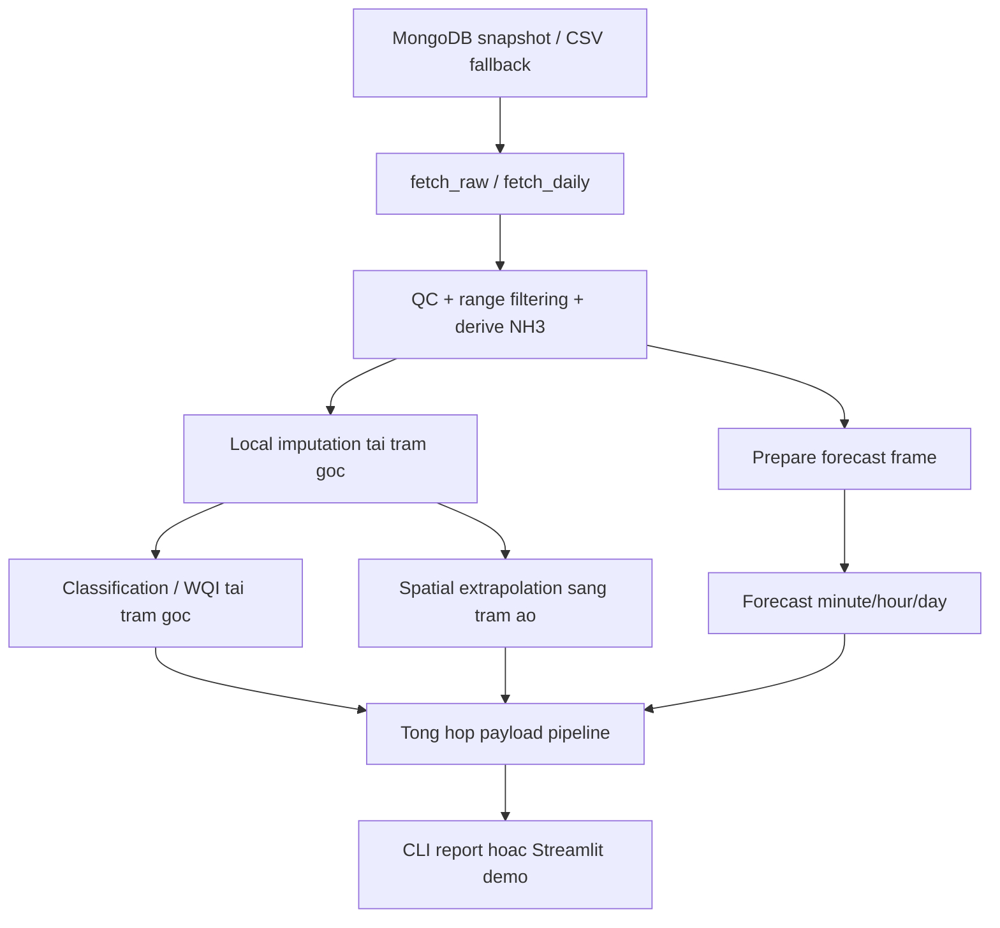

# He thong hoat dong nhu the nao

Tai lieu nay mo ta luong xu ly end-to-end dua tren code hien tai trong `core/` va `app/`. Muc tieu la giup nguoi doc hieu thu tu cac buoc va biet su khac nhau giua che do CLI report va che do demo app.

## Luong tong quat

## 1. Lay du lieu

He thong bat dau tu `fetch_raw(station_serial)` trong `core/fetch.py`.

- Neu `USE_LOCAL_CSV=true`, du lieu duoc doc tu `data/greenlab/greenlab_export.csv`.
- Neu khong, he thong thu doc MongoDB.
- Neu MongoDB loi va CSV co san, he thong fallback sang CSV va gan warning vao `DataFrame.attrs`.

Voi nhom bao cao theo ngay, `fetch_daily()` se:

- chuyen timestamp ve logic ngay
- loc range cho cac bien chinh
- tinh median theo ngay
- gan `cod_status`

## 2. QC va bien doi thong so

Truoc khi classify va forecast, he thong co 2 lop xu ly:

- loc gia tri bat thuong theo dai vat ly hop ly
- tinh NH3 tu NH4, pH, Temperature

Muc dich la dua du lieu ve trang thai co the su dung cho cac buoc suy luan tiep theo, thay vi dua truc tiep reading thieu/nhieu nhieu vao mo hinh.

## 3. Local imputation va classification

Khi co bo `measured` tai tram goc, `classify_station()` se:

- goi `impute_params()` de noi suy bien thieu
- phoi hop `measured`, `imputed`, `defaulted` thanh mot dong day du
- dua bo tham so day du vao `_classify_by_scoring()` tu `src/classification`
- tra ve score, label, ty le tham so khong do truc tiep, confidence, warning

Day la buoc tao ra ket qua "tram goc dang o muc phu hop nao".

## 4. Spatial extrapolation sang tram ao

Neu region la Hai Phong, pipeline tiep tuc suy dien sang tram ao bang `predict_virtual_stations()`.

Co che hien tai:

- dung bo tham so da day du hoa o tram goc lam vector dau vao
- nap cac mo hinh khong gian da luu
- du doan mot so bien cho tung tram dich
- dien phan con thieu bang median lich su cua tung tram
- cham lai WQI cho tung tram ao bang ham classify o muc score

Ket qua tra ve cho moi tram ao gom:

- `values`
- `imputed_by`
- `wqi`

## 5. Forecast ngan han

Song song voi suy dien tram ao, pipeline chay `forecast()`:

- chuan hoa `df_raw` thanh forecast frame
- tao `DO_imputed` phuc vu du bao DO
- nap model pretrained theo `region + granularity + param`
- du bao de quy cho `Temperature`, `pH`, `NH4`, `TSS`, `DO`
- quy doi tung moc du bao thanh WQI/label
- phat hien canh bao som nhu DO thap hoac nhiet do qua cao

Ket qua chinh cua buoc nay la:

- `timeline`
- `early_warnings`
- `extremes`

## 6. Tong hop payload pipeline

`run_pipeline()` trong `core/pipeline.py` gom ket qua tu cac buoc tren thanh mot payload chung:

- thong tin nguon du lieu va warning
- ket qua tram goc
- ket qua tram ao
- ket qua forecast
- lich su mot so lan quet gan nhat

Payload nay la diem giao nhau giua logic du lieu va lop giao dien.

## 7. Hai che do su dung chinh

## Che do 1: CLI report

Su dung `core/report.py` khi can:

- xem nhanh theo mot tram
- kiem tra ket qua monitor/classify
- chay tren may khong can giao dien

Che do nay phu hop cho:

- debug nhanh
- demo bang terminal
- doi chieu ket qua theo ngay

## Che do 2: Demo app realtime

Su dung `app/demo_app.py` khi can:

- hien thi ban do tram ao
- xem chuoi lich su va du bao
- doi granularity/horizon
- backtest truc quan ngay tren giao dien

Che do nay phu hop cho:

- trinh bay de tai
- giai thich pipeline cho nguoi xem
- so sanh thuc te va du bao

## Dieu can luu y

- Pipeline hien tai vua co thanh phan "runtime demo", vua co thanh phan "nghien cuu". Tai lieu nen doc theo chuc nang, khong nen suy dien rang moi script trong `experiments/` deu nam tren duong chay cua app.
- Spatial extrapolation va forecasting dang dua vao artifact da huan luyen san, nen tinh on dinh cua demo phu thuoc vao su ton tai dung cua cac file model.
