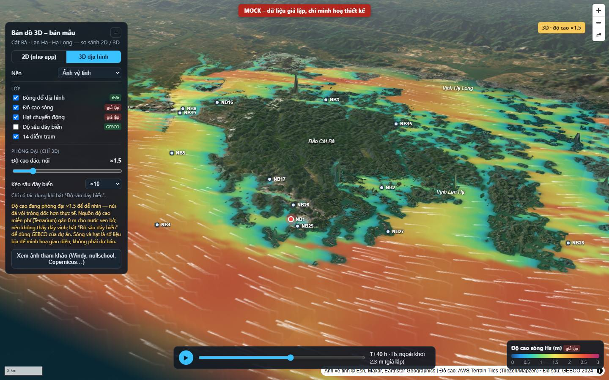
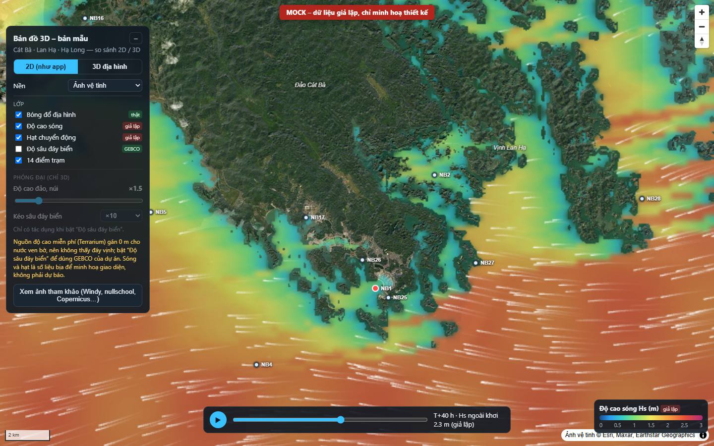
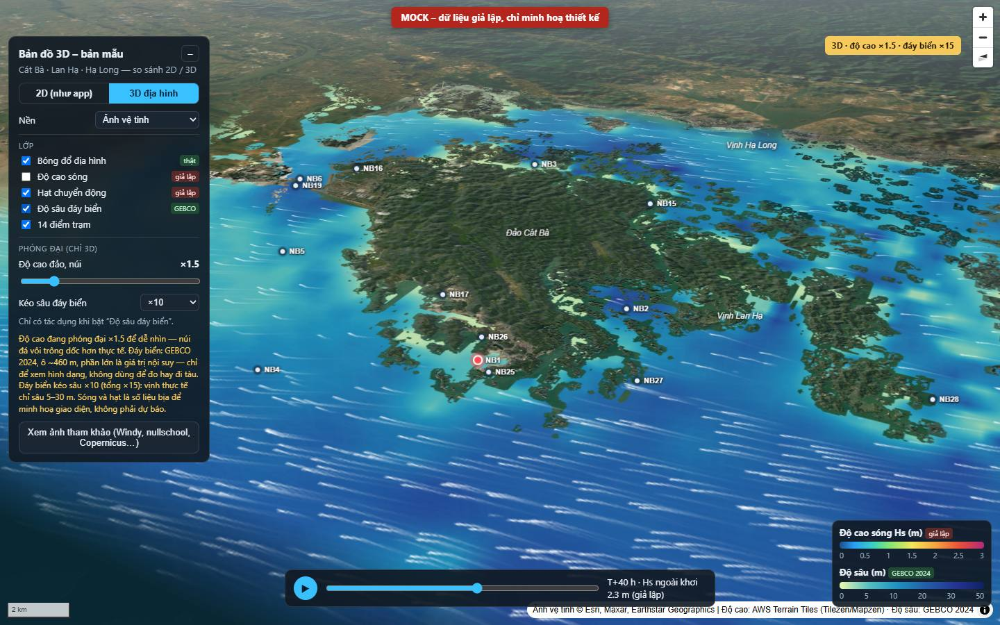

# Bản mẫu bản đồ 3D – Cát Bà / Hạ Long

> **MOCK – dữ liệu giả lập, chỉ minh hoạ thiết kế.** Trường sóng, hạt chuyển động, thanh thời gian và
> phần trăm "che chắn" trong bản mẫu là số liệu bịa. Không có gì ở đây được nối vào app `research-map/`
> (app chưa bị sửa).

Câu hỏi của chủ dự án: *"Có nên làm bản đồ sinh động hơn bằng 3D không?"* Thư mục này gồm:

- `index.html` – một trang độc lập để so sánh 2D (giống app hiện tại) và 3D địa hình.
- `shot-3d.jpg`, `shot-2d.jpg`, `shot-3d-bathy.jpg` – ảnh chụp bản mẫu (Playwright, 24/10/2026).
- `refs/` – ảnh chụp 8 bản đồ giám sát bên ngoài để tham khảo (xem cuối trang).

## Cách mở

1. Mở thẳng `docs/mock/3d/index.html` trong Chrome hoặc Edge (nháy đúp; không cần server).
2. Cần Internet: thư viện MapLibre GL JS 5.24.0 lấy từ unpkg, ảnh vệ tinh/nền xám từ Esri, độ cao
   từ AWS Terrain Tiles. **Không cần khoá API.**
3. Chờ khoảng 5–30 giây để tải địa hình, rồi thử:
   - **2D (như app) / 3D địa hình** – nút trên cùng của bảng. 2D khoá góc nghiêng về 0, giống Leaflet.
   - **Nền** – ảnh vệ tinh hoặc nền xám (cùng loại nền app đang dùng).
   - **Lớp** – bóng đổ địa hình (thật), độ cao sóng (giả lập), hạt chuyển động (giả lập),
     độ sâu đáy biển (GEBCO 2024, thật), 14 điểm trạm.
   - **Phóng đại** – thanh trượt độ cao ×1–×4 và "kéo sâu đáy biển" ×1/×10/×30/×60. Nhãn vàng góc phải
     luôn ghi đang phóng đại bao nhiêu.
   - **Thanh thời gian** – nút ▶ chạy 72 giờ giả lập; có một đợt gió mùa đông bắc giả quanh T+40 h để thấy
     vùng khuất sau đảo đổi màu.
   - Bấm vào một trạm: NB1 ghi "cảm biến thật (06M26042804)"; 13 điểm còn lại ghi "điểm lịch sử – dùng chung
     số liệu NB1" (đúng như app hiện tại).
   - **Xem ảnh tham khảo** – mở thư viện ảnh trong `refs/`.

Kiểm thử: trang được mở bằng `file://` trong Chrome (Playwright, `--use-angle=swiftshader`), chụp 3D, 3D + đáy biển,
2D, bấm trạm, mở thư viện ảnh, thu nhỏ về 390 px (điện thoại). **0 lỗi console, 0 lỗi trang**; chỉ có cảnh báo
hiệu năng của trình kết xuất phần mềm (`GPU stall due to ReadPixels`). Không có cuộn ngang ở 390 px.

| 3D địa hình (×1.5, T+40 h) | 2D như app (T+40 h) |
| --- | --- |
|  |  |

3D + độ sâu GEBCO (độ cao ×1.5, đáy biển kéo sâu ×10 ⇒ tổng ×15): 

## 1. Các bản đồ giám sát bên ngoài trông và hoạt động thế nào

| Bản đồ | Hiển thị | 2D/3D | Công nghệ | Điều nên học cho HAP |
| --- | --- | --- | --- | --- |
| [Windy.com](https://www.windy.com/) | Trường màu liên tục + hạt chuyển động (gió, sóng, dòng chảy); thanh thời gian 10 ngày ở dưới; chọn mô hình (ECMWF WAM, GFS Wave); bấm điểm xem dự báo. | 2D Leaflet; nút "3D" chỉ là quả địa cầu, **không có địa hình**, bản đầy đủ cần Premium (ảnh `windy-3d-globe.jpg`). | Leaflet + WebGL riêng cho hạt ([Windy Map Forecast API](https://api.windy.com/map-forecast/tutorials/parameters)) | Kiểu "màu + hạt + thanh thời gian" là chuẩn ngầm của người dùng. Ở zoom vịnh Lan Hạ, lưới ECMWF WAM gần như không có ô biển (ảnh `windy-waves.jpg`) – chính là khoảng trống mà HAP lấp được. |
| [earth.nullschool.net](https://earth.nullschool.net/about) | Hạt trên nền tối, màu cho đại lượng phụ (sóng, SST…), nhiều phép chiếu cầu. | 2D/phép chiếu cầu, không địa hình. | D3 + canvas; dữ liệu GFS/NOAA… ([giới thiệu](https://earth.nullschool.net/about), [cách vẽ hạt WebGL](https://blog.mapbox.com/how-i-built-a-wind-map-with-webgl-b63022b5537f)) | Ít nút, đẹp nhờ hạt; mọi thứ dồn vào một menu. |
| [Copernicus Marine MyOcean Pro](https://data.marine.copernicus.eu/viewer/expert) | Nhiều lớp chồng (dòng chảy dạng hạt + nhiệt độ…), thanh độ sâu, thanh thời gian nhiều năm, xuất GIF/video. | Có chế độ 3D địa cầu với địa hình và đáy biển độ phân giải cao ([hướng dẫn MyOcean Viewer](https://help.marine.copernicus.eu/en/articles/4794675-introduction-to-myocean-viewer)). | Ứng dụng web riêng (Lobelia) | Thanh độ sâu + thời gian rất hợp dữ liệu biển; 3D chỉ là một chế độ phụ, không phải mặc định. |
| [NOAA nowCOAST](https://nowcoast.noaa.gov/) | Bảng lớp bật/tắt, đường bão + nón dự báo, radar, cảnh báo; thanh thời gian (4 giờ qua → 7 ngày tới). | 2D. | ArcGIS/OGC WMS có thời gian ([NOAA](https://nauticalcharts.noaa.gov/learn/nowcoast.html)) | Bản đồ vận hành của một cơ quan nhà nước vẫn chọn 2D: dễ đọc, so sánh được. |
| [Global Fishing Watch](https://globalfishingwatch.org/map) | Lưới mật độ hoạt động tàu cá, biểu đồ thời gian ngay dưới bản đồ, lọc theo cờ/ngư cụ. | 2D (có quả địa cầu thu nhỏ). | deck.gl trên WebGL ([GFW](https://globalfishingwatch.org/?p=51911)) | Biểu đồ thời gian gắn vào thanh trượt rất đáng chép. |
| [Esri ArcGIS – TopoBathy 3D](https://elevation3d.arcgis.com/arcgis/rest/services/WorldElevation3D/TopoBathy3D/ImageServer) | Cảnh 3D có cả địa hình và đáy biển (`ground: "world-topobathymetry"`). | 3D. | ArcGIS Maps SDK for JS – SceneView ([tài liệu](https://developers.arcgis.com/javascript/latest/visualization/3d-visualization/terrain-rendering/)) | Đẹp nhất về đáy biển nhưng gắn hệ sinh thái Esri, cần khoá API/tài khoản cho dịch vụ. |
| Google Earth | Đáy biển 3D từ 2009 (lưới GEBCO_08 + Scripps/NOAA) ([GEBCO](https://gebco.net/news_and_media/gebco_08_google.html), [Scripps](https://scripps.ucsd.edu/news/scripps-dives-ocean-google-earth)) | 3D. | Ứng dụng đóng | Người xem quen hình "biển rút nước" – nhưng không nhúng được dữ liệu sống của mình. |
| Cesium | Cesium World Terrain + [Cesium World Bathymetry](https://cesium.com/blog/2024/01/23/introducing-cesium-world-bathymetry/) | 3D địa cầu. | CesiumJS, cần token Cesium ion | Mạnh nhất cho 3D toàn cầu, nặng nhất. |
| deck.gl | [TerrainLayer](https://deck.gl/examples/terrain-layer), lớp hạt/lưới trên MapLibre ([interleaved](https://deck.gl/docs/developer-guide/base-maps/using-with-maplibre)) | 2.5D/3D. | WebGL2 | Hợp khi có hàng chục nghìn điểm/ô; HAP chưa cần. |
| [MapLibre GL JS](https://maplibre.org/maplibre-gl-js/docs/examples/3d-terrain/) | Địa hình 3D, hillshade, fill-extrusion, trời/sương ([ví dụ hillshade](https://maplibre.org/maplibre-gl-js/docs/examples/add-a-hillshade-layer/)) | 2D ↔ 3D trong cùng một bản đồ. | WebGL, mã nguồn mở, không cần khoá với [AWS Terrain Tiles](https://registry.opendata.aws/terrain-tiles) | Lựa chọn rẻ nhất để thêm 3D; bản mẫu này dùng nó. |

Nhận xét chung: **các bản đồ giám sát vận hành (Windy, nowCOAST, GFW) đều 2D**; "sống động" đến từ hạt chuyển
động, trường màu mượt và thanh thời gian, không phải từ 3D. 3D xuất hiện như chế độ phụ (MyOcean, Windy globe)
hoặc ở công cụ trình diễn (Google Earth, ArcGIS Scene, Cesium).

## 2. So sánh công nghệ cho HAP

Dung lượng đo ngày 24/10/2026 bằng cách tải bản build từ unpkg rồi gzip (`curl … | gzip -c | wc -c`).

| | Leaflet 1.9.4 (hiện tại) | MapLibre GL JS 5.24 | deck.gl 9 (trên MapLibre) | CesiumJS 1.x | three.js tự viết |
| --- | --- | --- | --- | --- | --- |
| Dung lượng JS (gzip) | **43 KB** | **276 KB** (v6.15 ESM: 293 KB) | +576 KB (gói đầy đủ) | **1,78 MB** + worker/asset | lõi ~105 KB + renderer, cộng toàn bộ phần bản đồ tự viết |
| Địa hình 3D | Không | Có (`raster-dem` Terrarium, `setTerrain`) | Có (TerrainLayer) | Có, đẹp nhất | Tự làm hết |
| Đáy biển | Ô màu (đã có GEBCO) | Có nếu tự cấp DEM (bản mẫu: GEBCO qua `addProtocol`) | Tương tự | Cesium World Bathymetry (cần token ion) | Tự làm |
| Khoá API | Không | Không (Terrarium AWS, ảnh Esri) | Không | **Cần token Cesium ion** cho World Terrain/Bathymetry | Không |
| GPU | Canvas 2D, chạy mọi máy | WebGL; 2D nhẹ, 3D tốn hơn | WebGL2 | WebGL nặng; máy tính bảng/điện thoại cũ dễ nóng/giật | Tuỳ |
| Chuyển đổi từ app hiện tại | – | Viết lại lớp bản đồ: **27 file** đang import Leaflet, ~1.600 dòng trong `components/map/` (16 overlay canvas: hạt, lưới vô hướng, hoa gió che chắn…) | Như MapLibre + học deck.gl | Viết lại gần hết | Viết lại hết |
| Hợp với HAP | Vận hành hằng ngày | Trang 3D phụ, hoặc thay thế dần | Khi có dữ liệu rất dày | Không đáng | Không đáng |

### 3D thêm được gì cho bài toán nuôi lồng

- **Đảo đá vôi che lồng nuôi** – nhìn nghiêng thấy ngay điểm nào nằm trong vụng khuất sau núi (như NB1 trong
  vịnh Cát Bà) và điểm nào ở luồng hở (như NB4 ngoài phao số 0). Đây là giá trị thật nhất: giải thích hoa
  gió/sóng che chắn cho người không quen đọc bản đồ. (Mức che chắn % trong bản mẫu là giả lập.)
- **Hình dạng đáy vịnh** – lạch sâu Lạch Huyện, bãi cạn quanh Cát Bà. Nhưng vịnh chỉ sâu 5–55 m; muốn thấy
  trong 3D phải kéo sâu ×10–×60 (xem rủi ro).
- **Đường bão trên địa hình** – trông ấn tượng, nhưng bão có bán kính hàng trăm km; ở mức zoom đó địa hình
  Cát Bà phẳng và 3D không thêm thông tin. Đường bão hợp với 2D hơn (như nowCOAST).
- 3D **không** làm số liệu chính xác hơn. Ở góc nghiêng 60°, vùng xa bị nén và che sau núi, khó so sánh màu
  giữa hai điểm – vì thế các bản đồ vận hành vẫn dùng 2D.

### Rủi ro trung thực (quan trọng)

1. **Phóng đại độ cao.** Ở ×1.5 núi đá vôi đã trông dốc hơn thực. Đáy biển kéo sâu ×10 (tổng ×15) biến bãi
   10 m thành vách 150 m – đẹp nhưng dễ hiểu sai. Bản mẫu luôn hiện nhãn "độ cao ×…, đáy biển ×…"; nếu làm thật
   phải giữ quy tắc này.
2. **GEBCO 460 m trông "chính xác" khi dựng 3D.** Trong khung dữ liệu của dự án, 69.843/74.704 ô biển (93%)
   là giá trị nội suy (TID 40), chỉ ~3,7% là đo trực tiếp (TID 11/14/17). Bề mặt 3D mượt khiến người xem tưởng
   có khảo sát chi tiết. GEBCO cũng ghi rõ "không dùng để đi biển".
3. **Terrarium (AWS) không có đáy vịnh.** Kiểm tra trực tiếp ô z11–z12 quanh Cát Bà: điểm biển ≈ 0 m (−0,5…0 m; SRTM
   gán 0 cho mặt nước); độ sâu ETOPO1 (~1,8 km) chỉ xuất hiện ngoài khơi ở z10 (−5…−20 m). Vì vậy nút "Độ sâu
   đáy biển" của bản mẫu dùng **GEBCO 2024 của dự án** (`data/depth/gebco2024-20261023`, nhúng sẵn ~170 KB),
   không dùng Terrarium.
4. **Terrarium có gai nhiễu.** Ô z12 vịnh Lan Hạ có điểm +1.543 m và −1.995 m; z14 có −1.867 m. Không lọc thì
   hiện "kim" cao vài trăm mét giữa vịnh. Bản mẫu lọc: điểm lệch > 80 m so với cả 8 ô lân cận → lấy trung vị.
5. **Mock phải luôn có nhãn.** Banner đỏ cố định, nhãn "giả lập" ở từng lớp, chú thích và popup (AGENTS.md
   quy tắc 4).
6. **Lớp `color-relief` của MapLibre** hiển thị sai (bạc màu) trên địa hình 3D trong lần thử bằng trình kết xuất
   phần mềm; bản mẫu thay bằng ảnh màu tự vẽ phủ lên. Chưa kiểm tra trên GPU thật.

## 3. Khuyến nghị

1. **Giữ Leaflet 2D cho bản đồ vận hành** (trạm, cảnh báo, dự báo). Đó cũng là lựa chọn của Windy/nowCOAST/GFW.
2. **Thêm một trang 3D tuỳ chọn "Địa hình & che chắn"** bằng MapLibre GL JS, tải lười (chỉ tải 276 KB khi mở
   trang), dùng địa hình Terrarium đã lọc gai + GEBCO của dự án, hiển thị trạm và hoa sóng/gió che chắn thật.
3. **Không chuyển toàn bộ sang MapLibre lúc này**: 27 file/16 overlay Leaflet phải viết lại mà không thêm giá
   trị dự báo; thứ tự ưu tiên trong `docs/roadmap.md` là độ sâu dự báo và khuyến nghị theo thời tiết.
4. Muốn "sống động" ngay trong 2D: làm hạt mượt hơn, trường màu nội suy, thanh thời gian kiểu Windy – rẻ hơn 3D.
5. Xem lại việc chuyển hẳn sang MapLibre chỉ khi cần vector tile/xoay bản đồ cho nhiều trang, hoặc Leaflet
   canvas không theo kịp số lớp.

### Ước lượng công sức (1 người, đã quen mã nguồn)

| Hạng mục | Ước lượng |
| --- | --- |
| Trang 3D phụ: React wrapper MapLibre, lazy chunk, địa hình + hillshade + lọc gai, trạm, popup | 2–3 ngày |
| Phục vụ GEBCO thành ô DEM từ backend (thay vì nhúng), ghi nguồn/TID, nhãn phóng đại | 1–2 ngày |
| Hoa sóng/gió che chắn và trường sóng **thật** từ API hiện có lên trang 3D | 2–3 ngày |
| Kiểm thử máy yếu/điện thoại, chế độ dự phòng khi không có WebGL | 1 ngày |
| **Tổng trang 3D phụ** | **~1–1,5 tuần** |
| Chuyển toàn bộ bản đồ sang MapLibre (27 file, 16 overlay, hạt, LOD, kiểm thử) | ~3–5 tuần |

## 4. Chi tiết kỹ thuật của bản mẫu

- MapLibre GL JS 5.24.0 (bản UMD, chạy được với `file://`; bản 6.x chỉ có ESM).
- Địa hình: `raster-dem` mã hoá Terrarium, `maxzoom: 15`, qua giao thức `hapdem://` (`maplibregl.addProtocol`)
  để lọc gai và – khi bật đáy biển – thay ô biển (≤ 1 m) bằng độ sâu GEBCO × hệ số kéo sâu.
- Trường sóng giả lập: lưới 220 ô; Hs = Hs ngoài khơi × hàm của "fetch" (khoảng nước trống ngược hướng sóng tới
  đảo gần nhất, từ mặt nạ đất/biển Terrarium z12 ~36 m). Vẽ thành ảnh phủ có mặt nạ đảo; hạt là `canvas` source
  bám theo địa hình. Đây là minh hoạ – không phải mô hình sóng.
- Khung trường sóng: 106,80–107,32°E × 20,62–20,96°N (bao cả 14 trạm); ngoài khung không có lớp giả lập.
- Toạ độ 14 trạm: `data/map/station_coordinates.csv` (chỉ đọc).
- Hiệu năng (đo bằng đếm `requestAnimationFrame` trong 4 giây, cửa sổ 1440×900):
  - GPU Intel Iris Xe (máy dev, Chrome + D3D11): **60 khung/giây** cả 2D lẫn 3D.
  - Không có GPU (SwiftShader, kết xuất phần mềm): **~0,25 khung/giây ở 3D, ~1 khung/giây ở 2D** – gần như
    đứng hình. Nghĩa là trang phụ thuộc hoàn toàn vào WebGL tăng tốc; máy tắt tăng tốc phần cứng hoặc máy ảo
    sẽ không dùng được. Hạt dùng bước cố định (tối đa 4 bước/khung) nên tốc độ hạt không đổi khi máy chậm.
  - **Chưa đo trên máy tính bảng/điện thoại thật.**

## 5. Ảnh tham khảo (`refs/`, chụp 24/10/2026, trang công khai, không đăng nhập)

| Tệp | Nguồn |
| --- | --- |
| `refs/windy-waves.jpg` | https://www.windy.com/-Waves-waves?waves,20.55,107.30,9 |
| `refs/windy-3d-globe.jpg` | https://www.windy.com/ (nút "3D") |
| `refs/nullschool-waves.jpg` | https://earth.nullschool.net/#current/ocean/primary/waves/overlay=significant_wave_height/orthographic=107.00,19.00,1800 |
| `refs/myocean.jpg` | https://data.marine.copernicus.eu/viewer/expert |
| `refs/nowcoast.jpg` | https://nowcoast.noaa.gov/ |
| `refs/gfw-map.jpg` | https://globalfishingwatch.org/map (đã đóng hộp thoại chào) |
| `refs/cesium-sandcastle.jpg` | https://sandcastle.cesium.com/ (CesiumJS 1.146) |
| `refs/maplibre-3d-terrain.jpg` | https://maplibre.org/maplibre-gl-js/docs/examples/3d-terrain/ |

Không có ảnh ArcGIS: đã thử trang mẫu công khai [Intro to SceneView](https://developers.arcgis.com/javascript/latest/sample-code/intro-sceneview/) nhưng khung xem trước để trống trong trình duyệt tự động (có hộp cookie). Google Earth không chụp (chưa thử; bản web cần đăng nhập/ứng dụng).

## Nguồn dữ liệu trong bản mẫu

- Ảnh vệ tinh / nền xám: Esri World Imagery, World Light Gray Canvas.
- Độ cao: [AWS Terrain Tiles](https://registry.opendata.aws/terrain-tiles) (Tilezen/Mapzen; SRTM, GMTED, ETOPO1).
- Độ sâu: GEBCO Compilation Group (2024) GEBCO 2024 Grid, doi:10.5285/1c44ce99-0a0d-5f4f-e063-7086abc0ea0f –
  public domain, không dùng để đi biển.
